# Run a Git repository inside Docker

This lab runs a public Python repository from a fresh checkout. The default is the Python Packaging Authority's sample project. It declares `peppercorn` as a dependency and exposes a command called `sample`. [Sample project configuration](https://github.com/pypa/sampleproject/blob/main/pyproject.toml)

## Try it from PowerShell

With Docker Desktop running in Linux container mode, run these commands from this directory.

```powershell
docker build -t repo-lab .
docker run --rm repo-lab
```

Look for the checkout's commit hash, pip's installation of `peppercorn` and `sampleproject`, then the application's own output, `Call your main application code here`.

## What happens where

| When | What happens |
| --- | --- |
| Build the image once | Docker installs Git and CA certificates alongside Python 3.12 and creates a virtual environment owned by the Linux user `runner`. |
| Start a container | Git uses outbound HTTPS to clone the repo into `/home/runner/repo`. Pip installs the checked-out package and its declared dependencies into the virtual environment. |
| Run the program | From the checkout, the script starts the command you supplied. Its output goes to your terminal and its exit code becomes the container's exit code. A clone or installation failure stops the run early. |
| Finish | `--rm` deletes this container, its checkout and installed packages. The image remains available for the next run. |

The host needs Docker and network access. The experiment uses the container's own filesystem, without host directory mounts or credentials. Use a repository you trust since both installation and startup can execute its code.

## Architecture

The image contains Git, Python, pip, and the entrypoint script. Each new container clones the repository, installs the project and its dependencies, and starts the application's command.



### How dependencies are discovered and downloaded

Running `python -m pip install .` tells pip to install the project in the current directory. Pip uses the build backend declared in `pyproject.toml` to obtain package metadata, resolves the declared dependencies, and downloads compatible packages from the configured package index. In this example, setuptools builds the application and pip downloads peppercorn from PyPI.



### Where the files go

Git creates the source checkout at `/home/runner/repo`. Pip installs the application and runtime libraries into `/home/runner/venv/lib/python3.12/site-packages` and creates the `sample` launcher in `/home/runner/venv/bin`. Temporary build tools live under `/tmp`. Removing the container deletes its checkout and installed packages, while the reusable image remains available.



The full walkthrough includes the actual dependency declarations, inspection commands, and engineering discussion notes. Open the HTML file locally in a browser to read it. [Full architectural walkthrough](docs/container-architecture.html).

## Explore interactively

To inspect the installed sample, run `docker run --rm -it repo-lab sh`. You'll land in the checkout after installation. Try `pwd`, `git log -1 --oneline`, `python -m pip show peppercorn`, and `sample`. Type `exit` when finished.

To do the whole experiment by hand, start before the clone.

```powershell
docker run --rm -it --entrypoint sh repo-lab
```

Then run these commands inside the Linux shell.

```sh
git clone https://github.com/pypa/sampleproject.git repo
cd repo
python -m pip install .
sample
exit
```

## Bring another repository

For another pip-installable Python repo, supply its public HTTPS URL and documented launch command. Replace the example values below. Omit `REPO_REF` to use the default branch, or set it to a branch or tag.

```powershell
docker run --rm -e REPO_URL=https://github.com/OWNER/REPO.git -e REPO_REF=BRANCH_OR_TAG repo-lab python -m MODULE
```

The repo determines the runtime, installation step, and launch command. For a Python script repo with only a requirements file, use the manual shell above, clone the repo, run `python -m pip install -r requirements.txt`, then launch its script. For a Node.js repo with a package-lock file, the same architecture uses an image with Node and Git, an `npm ci` install step, and the project's start script. Add any required OS libraries when building the image. For a web server, have the app listen on `0.0.0.0` and publish its port at startup, for example `-p 127.0.0.1:8000:8000` for a service listening on port 8000.
